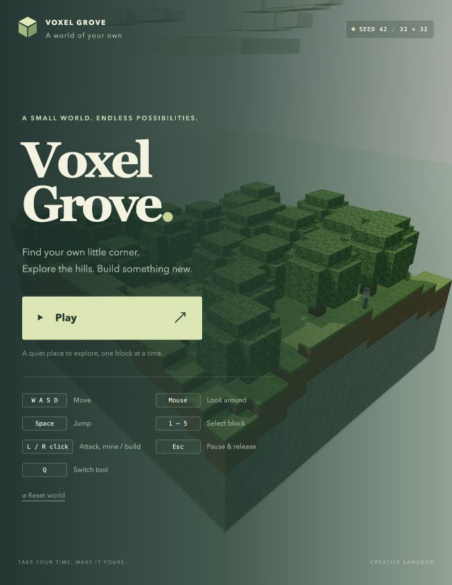
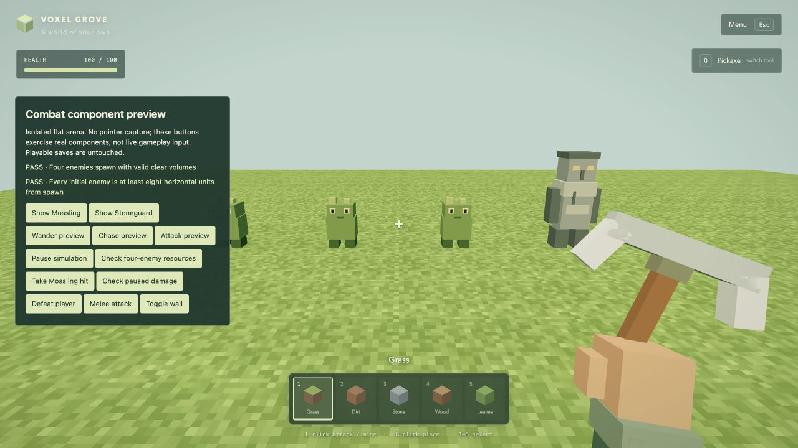
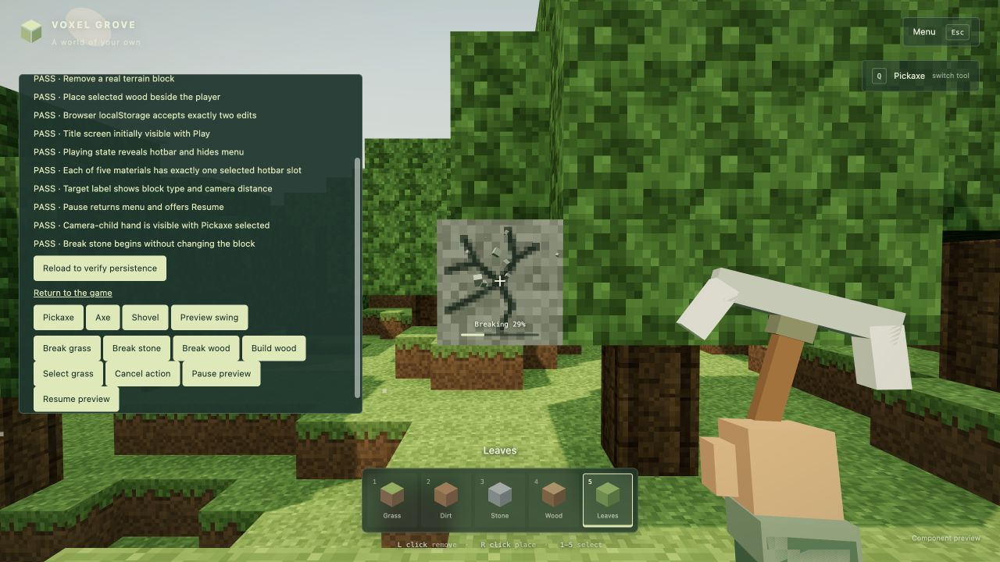

# Voxel Grove

A small, local 3D voxel sandbox built with JavaScript, Three.js, and Vite. Explore a deterministic grove, build with five materials, and defend yourself against Mosslings and Stoneguards. Original procedural voxel models, held tools, animated mining/building, combat, health, and respawn run entirely in your browser. No backend, paid services, or external asset requests are required.

Project milestones, verification results, and known limitations are documented in [DEVELOPMENT_LOG.md](DEVELOPMENT_LOG.md). The base requirements are retained in `SPEC.md`, and the combat extension requirements in `EXTENSION_MOBS_HEALTH.md`.



## Install and run

Use Node.js **20.19+ or 22.12+** (Node 22 LTS or newer recommended), npm, and a modern desktop Chromium browser with WebGL 2 and pointer lock.

```sh
npm ci
npm run dev
```

Open the local address printed by Vite, normally **http://127.0.0.1:5173/**, in desktop Chrome or Edge. Click **Play** to capture the mouse. Press **Escape** to pause and release it; click **Resume** to continue. If a browser does not permit pointer lock, the menu reports the issue and gameplay remains paused.

```sh
npm test          # Node's built-in test runner; no test dependency needed
npm run build    # Production files in dist/
npm run preview  # Serve the production build, normally on port 4173
```

Vite uses its standard ES-module build configuration; `vite.config.js` binds development and preview servers to the local machine. A local HTTP server is required: opening `index.html` directly is unsupported.

## Controls

| Input | Action |
| --- | --- |
| W / A / S / D | Move forward / left / backward / right |
| Mouse | Look around |
| Space | Jump while grounded; release before jumping again |
| Left click | Strike a visible enemy within three units; otherwise start one-second block mining |
| Right click | Start a one-second construction preview against the targeted face |
| 1 / 2 / 3 / 4 / 5 | Select grass / dirt / stone / wood / leaves |
| Q | Cycle Pickaxe → Axe → Shovel; cancel any current interaction |
| Escape | Pause and release the mouse |
| Respawn button | Restore health, return to a safe clearing, and reset enemies after death |

A light outline identifies the block under the crosshair. The label below it shows material/distance, or an enemy's name/HP/distance. Editing is limited to **six world units**. Placement rejects occupied space, world boundaries, the player, and living creatures. Jump to climb a one-block ledge. There is no flight, sprint, inventory limit, crafting, or audio.

## Creatures, combat, and health

Three Mosslings and one Stoneguard spawn in clear, supported positions, at least eight horizontal units from the initial player spawn. Their simple rule-based behavior wanders when distant, chases within ten units, and attacks within 1.75 units with an unobstructed path. Each creature attacks at most once per 1.5 seconds. Detection/attack distances use entity feet in 3D; your melee reach uses the actual visible surface distance from the camera.

| Creature | Health | Damage | Chase speed |
| --- | --- | --- | --- |
| Mossling | 40 HP | 10 HP | 1.3 units/second |
| Stoneguard | 60 HP | 15 HP | 0.8 units/second |

Aim at a visible enemy within **three units** and left-click to deal **25 damage**, with a **0.6-second cooldown**. Any held tool works. Two hits defeat a Mossling; three defeat a Stoneguard. Nearer terrain blocks melee and retains its normal mining behavior. A creature outside melee reach still obstructs mining through its model. Hits flash the creature; defeated creatures shrink away briefly and immediately stop attacking or blocking targeting.

The health bar starts at **100 HP**. Enemy attacks produce a brief damage vignette; health does not regenerate. At zero HP, gameplay stops and the death screen offers **Respawn**. Respawning restores health and safe player/enemy positions without changing your buildings or saved edits. Health and enemies are session state and reset on reload; resetting the entire world also restores health/enemies. Menus, lost focus, hidden tabs, and death stop gameplay damage.



## Hand, tools, and animated interactions

The blocky right hand and forearm stay attached to the camera, with subtle idle motion and walking bob. The held tool and a small **Q** label show your active tool. Tools are visual: any of the three can break any editable block. Tool selection and the five-slot building hotbar are independent.

A single click starts an operation; you do not need to hold the button. Keep aiming at the block until the progress bar finishes:

- **Breaking:** the hand chops, cracks grow through four damage stages, and small material-colored voxels scatter from the hit point. The original block remains solid and visible until completion.
- **Building:** a translucent, textured preview grows into the destination while small construction voxels move inward. The destination remains empty and non-solid until completion. The preview and final block use the material selected when you clicked, even if you change hotbar slots during the animation.
- Only one operation runs at a time. Further left/right clicks are ignored until it completes or cancels. Movement and camera controls continue normally.
- Looking away, losing reach, changing the source block, changing the placement face, or occupying the construction cell cancels safely. A player or creature entering a preview cancels it before a block can appear inside them. A creature crossing your mining aim also interrupts the operation.
- Switching tools, pausing/releasing capture, losing focus, hiding the tab, dying, or resetting the world cancels the operation and removes its cracks, preview, particles, and swing. Menus hide the hand and block gameplay inputs.
- World data, collision, mesh rebuilding, and saving change only after a successfully revalidated completion. Partial/cancelled operations are never saved.



## World and saving

- Seed **42** generates the same 32 × 32 terrain, trees, and spawn clearing every time.
- Editable coordinates are **x/z 0–31**, **y 0–47**. Blocks occupy unit cells; the player is 0.6 units wide and 1.75 units tall.
- Horizontal boundaries and the floor at y=0 keep the player inside the finite world, even after digging out the lowest layer. Water, clouds, and dust motes are scenery; they are not editable blocks or collision surfaces.
- Each completed edit saves immediately to localStorage under `voxel-grove:world:v1`. The save format is unchanged; existing saves remain compatible. Only modifications are stored. Reloading restores edits and chooses a clear spawn; player position, block selection, tool selection, and partial animations are not saved.
- In the pause/title menu, click **Reset world**, then click its confirmation within five seconds to discard changes and restore the original grove.
- Saves belong to this browser and origin. Changing hostnames, ports, browser profiles, or clearing site data creates a separate save or removes it. No data is sent to a server.
- Corrupt or incompatible data is ignored atomically. If storage is denied or full, gameplay continues for the current session and the interface reports that saving is unavailable. If deleting storage is denied, reset still restores the session but cannot guarantee clearing the old persistent save.

## Implementation

| File | Responsibility |
| --- | --- |
| `src/main.js` | Scene, game loop, and connection of input, world, and UI |
| `src/world.js` | Bounded byte-array storage and seeded terrain/tree generation |
| `src/world-mesh.js` | Indexed exposed-face geometry and corner contact shading |
| `src/physics.js` | Fixed-step AABB collision, gravity, jumping, safe spawn |
| `src/controls.js` | Pointer-lock-gated keyboard/mouse input and focus cleanup |
| `src/interactions.js` | Visible-face raycasting and validated edits |
| `src/interaction-controller.js` | One pending operation, one-second timing, continuous validation, cancellation, once-only commit |
| `src/first-person.js` | Camera-child hand/tool geometry, independent tool state, idle/bob/swing motion, foreground rendering |
| `src/interaction-effects.js` | Progressive crack textures, construction preview, bounded voxel-particle pool, owned-resource cleanup |
| `src/mobs.js`, `src/mob-view.js` | Deterministic safe spawns, wander/chase/attack, original creature geometry and reusable animation |
| `src/visibility.js`, `src/combat.js` | Voxel attack-path occlusion, nearest visible melee target, damage and cooldown |
| `src/health.js`, `src/respawn.js` | Clamped health math and safe session-entity reset without world mutations |
| `src/storage.js` | Versioned edit-only persistence and reset |
| `src/ui.js`, `src/style.css` | Title/pause menu, controls, crosshair, hotbar, feedback |
| `src/textures.js`, `src/atmosphere.js` | Procedural atlas, sky, clouds, water, and particles |

The world is one mesh with hidden faces omitted. Old geometry is disposed after edits; shadows refresh only after geometry changes. Fixed 1/120-second physics steps, capped frame deltas, and a terminal fall speed keep movement stable. Rendering resolution is capped at twice CSS resolution.

The existing frame loop advances the interaction timeline with elapsed seconds while physics retains its fixed/capped steps. `validateEdit` is shared by start, update, and final commit. Effects stay outside the raycastable world mesh. A depth-cleared foreground pass renders the camera-attached hand without terrain clipping. Four crack textures and 48 reusable particle slots bound effect allocations; expired/cancelled particles release their slots. Components expose explicit disposal of their owned GPU resources; the shared block atlas remains owned by the world.

Enemies reuse the same dimension-aware AABB solver and fixed steps. Their movement and attack decisions are local, rule-based behaviors with no navigation service. Melee compares actual block/model raycast distances before applying damage. Creature hit/death animations reuse existing meshes/materials; reset preserves entity identities. Moving creatures receive world shadows without casting stale shadows into the otherwise static shadow map.

## Validation and limitations

`npm test` passes **56 tests**. Original world/physics/raycast/storage, tools, and timed-edit regressions remain. Combat checks cover valid deterministic spawns, both creature body sizes/speeds/damage, wander/chase/attack, walls/trees/bounds/gravity, 1.5/0.6-second cooldowns, melee priority/reach, health clamping/pause/death, construction occupancy, safe respawn with obstructing saved blocks, unchanged saves, animation at 20/60/120 update rates, and 100 model reset/disposal cycles. `npm run build` succeeds.

While the development server is running, open **`/tests/browser-checks.html`** at the address Vite prints (normally http://127.0.0.1:5173/tests/browser-checks.html; another port is selected if occupied). **Reload to verify persistence** checks the original save flow. Tool buttons, **Preview swing**, **Break grass/stone/wood**, **Build wood**, **Select grass**, **Cancel action**, and **Pause/Resume preview** exercise the actual view/controller/effect components. After an animated edit completes, **Reload timed save** verifies its real localStorage data byte-for-byte after refresh and clears that isolated save. The playable world's save is never used by these checks.

This page is explicitly a **component preview**; it does **not** capture the mouse or claim to test real gameplay input. These developer checks are not included in the production build.

Also open **`/tests/combat-checks.html`** on the development server. Its labelled buttons inspect both creature types, wander/chase/attack states, paused damage, wall occlusion, melee, death/respawn, and bounded four-enemy rendering. **Defeat player → Respawn** checks actual browser storage preservation using a disposable, separate test key. Combat-state observations are exposed on the preview panel for inspection. These are real component checks with explicit fixture controls, not tests of captured mouse/key gameplay.

Browser-based validation performed during development:

- The rebuilt production game launched at 653 × 844 with the combat control guide, 100 HP, hidden death dialog, and empty warning/error logs. Menu Q/5 left Pickaxe/Grass unchanged. Component previews were inspected at 1280 × 720. The original animated-save reload regression reported 13 passing checks and zero failures.
- Real localStorage persistence across reload and reset passed both the original and completed-animation browser checks. The five-slot hotbar and UI transitions were visually inspected and programmatically checked in the component preview. All three held models, swing motion, progressive cracks and debris on grass/stone/wood, and translucent construction were inspected. Mid-operation data remained unchanged; completed effects cleared. Changing the hotbar during a Wood build still completed Wood.
- Combat preview checks displayed both models and their wander/chase/attack states, applied melee/enemy damage, blocked wall hits, observed player death and the Respawn dialog, and restored safe full-health entities while preserving saved world bytes. A rendered frame showed the brief enemy death effect before disappearance. A four-enemy run retained three geometries/one texture across 120 rendered frames in the isolated arena.
- **Pointer capture was unavailable in the test browser.** The game handled this limitation without an unhandled error. Mouse-look, held-key movement/jumping, Q cycling, click-driven gameplay, and Escape release still require a desktop browser smoke test. Component buttons and synthetic input tests do not substitute for that check.
- Respawn's actual pointer-capture gesture, combat driven by real clicks, and live player movement around enemies remain unverified for the same capture limitation. Enemy behavior intentionally stops/slides at obstacles; it does not jump or navigate around hills. Creatures can overlap one another. These simple behaviors are permitted by the extension specification.
- The production build has a non-fatal Vite advisory for its roughly 579 kB JavaScript bundle (about 149 kB gzip), primarily Three.js. No dependencies were added by either extension. No cross-device frame-rate benchmark or full heap-profiler audit was performed. Resource reuse/disposal tests and the isolated browser sample check bounded behavior. Full-world meshing remains appropriate for this finite scene, not an infinite-world architecture.

No critical logic failure is known from the executed checks. Desktop pointer-lock gameplay remains the outstanding verification limit.
